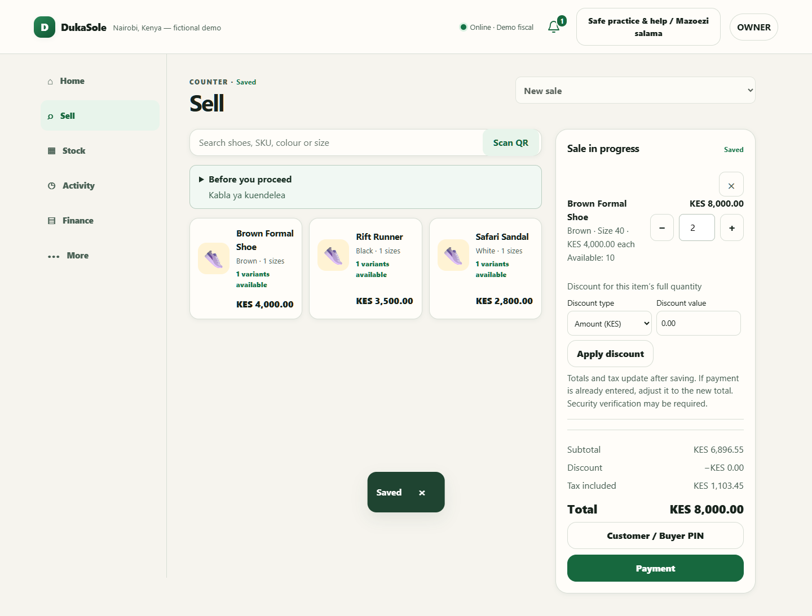

# DukaSole — engineering showcase

**[Open the public guided walkthrough](https://dukasole-reviewer-tour.honey-nova-6116.chatgpt.site)** · [Architecture](docs/PORTFOLIO_ARCHITECTURE.md) · [Selected engineering](docs/ENGINEERING.md) · [Screenshots](docs/SCREENSHOT_WALKTHROUGH.md)

DukaSole is a retail operations system personally developed by **Uwaziman1**: checkout, QR product selection, stock, permissions, accounting, reporting and customer documents. This smaller public repository demonstrates selected engineering; **the full application is private**.

It contains selected JavaScript implementation files, runnable focused tests, read-only reference acceptance specifications, architecture and nine real screenshots using isolated fictional data. It contains no working business database, tenant records, credentials, complete backend, authentication implementation or deployable till. It has a fresh history and is not a fork of the full application.



## What reviewers can verify here

- **One Nairobi business calendar:** the same browser-safe IANA timezone module is consumed through the Node facade; midnight, month-end and year-end boundaries are executable tests.
- **Immutable document provenance:** a canonical business snapshot is separate from versioned presentation/export metadata. Tests allow legitimate presentation changes but reject changed economics, buyer, payment, identity or linkage.
- **Read-only document meaning:** receipt, tax invoice, credit and copy semantics do not create another transaction. Recorded payments are not asserted to be bank settlement.
- **Exactly-once accounting design:** a source-derived persistence-guard excerpt and reference regression specifications show how the private system prevents duplicate authoritative postings.
- **Integration and presentation boundaries:** selected [QuickBooks report and fictional USD contracts](docs/QUICKBOOKS_DEMO.md) verify dates, currencies, cents, journal economics and report deltas. Dated USD/KES/EUR display conversion, bilingual charts and comparison tables never change source records or enable business export.
- **Real visual evidence:** the screenshot fixture completed a KES 8,000 sale and checked a balanced Balance Sheet. Screenshots are not mockups; the hosted site is a screenshot tour, not the running application.

## Run the focused showcase tests

Use Node.js **24.7.0 or newer**; this showcase was checked with Node **24.19.0**. No package installation, database migration, login, Python runtime or external connector is required for these focused tests.

```sh
node --test
```

The original private application recorded **279 passing local tests, 0 failing** on 11 October 2026. The full suite is **not** included or claimed to run here. Files in `references/` are source-derived integration specifications for review; they depend on private modules and are not part of the runnable showcase suite. See [validation and disclosure](docs/VALIDATION.md) for the current focused test result and its limits.

## Integration boundaries

This demonstrates an internal tool, business-workflow automation and financial integration contracts. The private local QuickBooks sandbox module is separate from the working till; real DukaSole transaction export is off. This repository does not claim an implemented autonomous AI agent or active KRA/eTIMS, OSCU/VSCU, Daraja or SMS service. Recorded mobile-money allocations do not establish provider settlement. Local sample tax documents are not live KRA issuance or regulator approval.

The working application's login and permissions remain intact. A reviewer cannot operate the full application from this repository or the hosted tour. Access to the private application requires a separate arrangement with its owner.

## Copyright and security

**Copyright (c) 2026 Uwaziman1. All rights reserved.** This is not MIT/Apache-licensed; see [LICENSE](LICENSE). Public visibility and copyright restrictions do not technically prevent copying, and remain subject to applicable law and GitHub's terms.

Only selected code and reviewed fictional assets belong here. Secrets, auth keys and tenant databases must remain separate. GitHub secret scanning and push protection detect supported patterns—not every leak—and do not replace a review of source, history and screenshots. See [publication boundary](docs/PUBLICATION_BOUNDARY.md).
