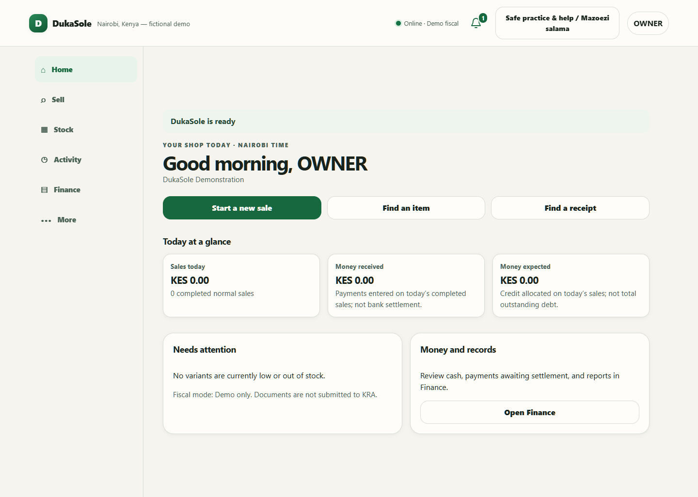
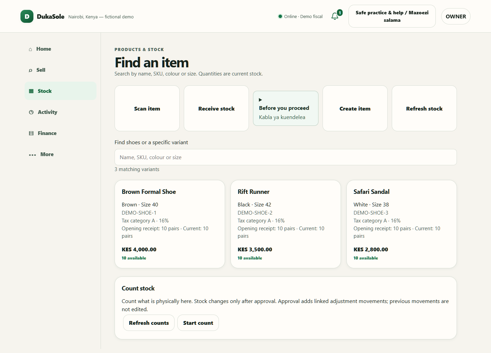
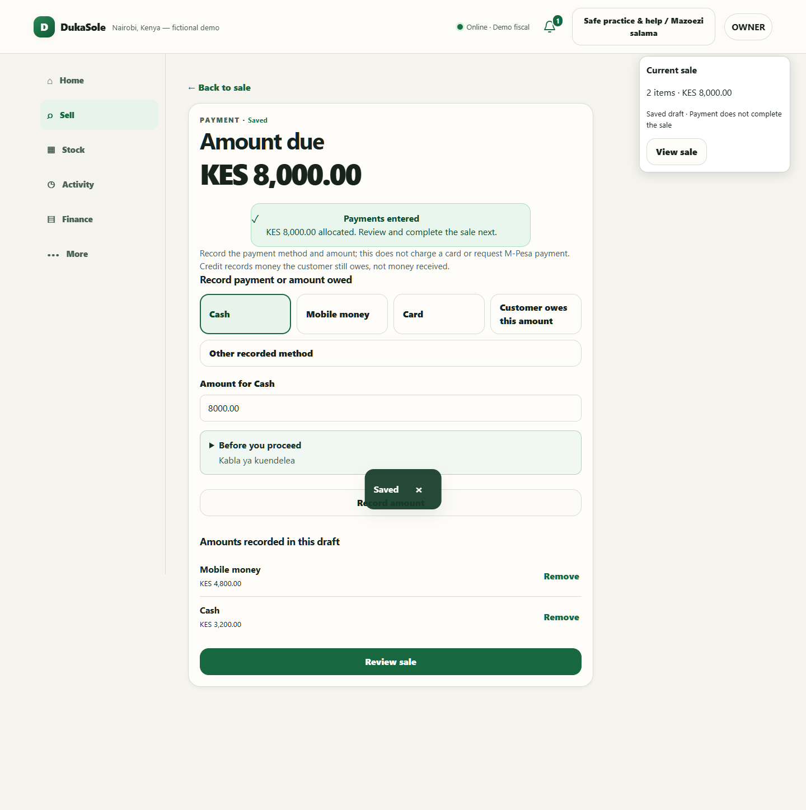
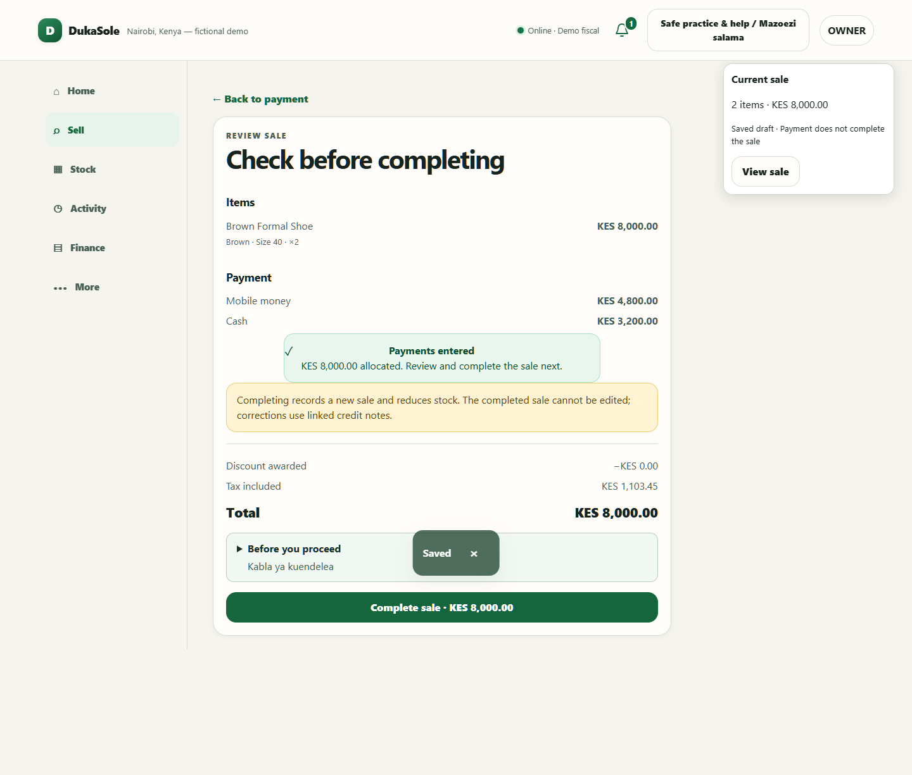
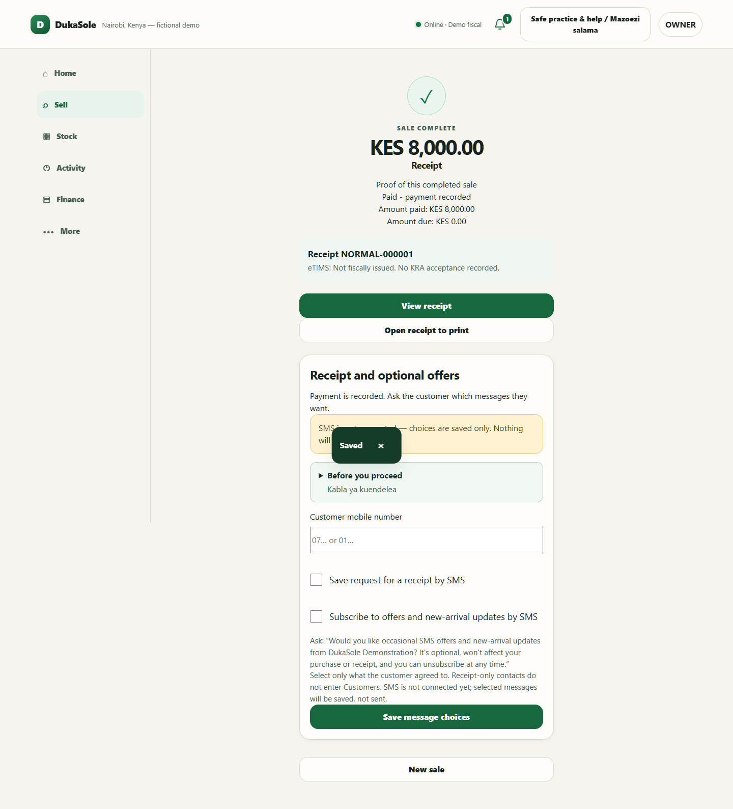
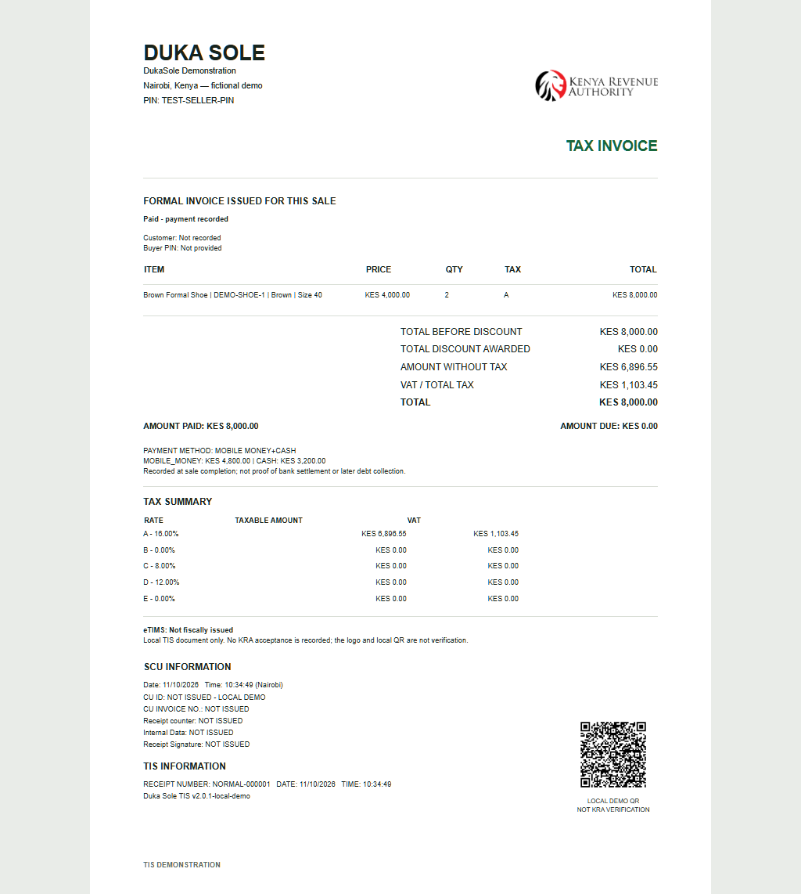
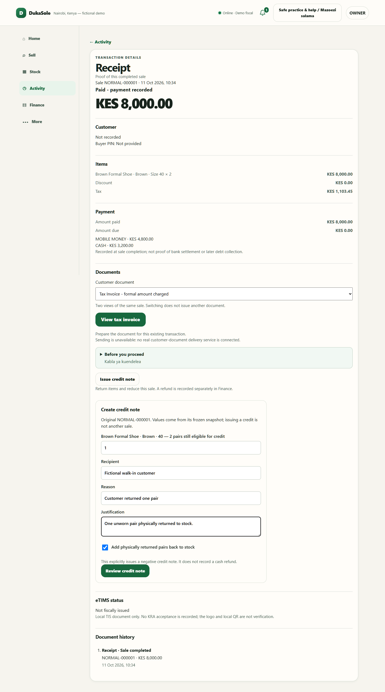
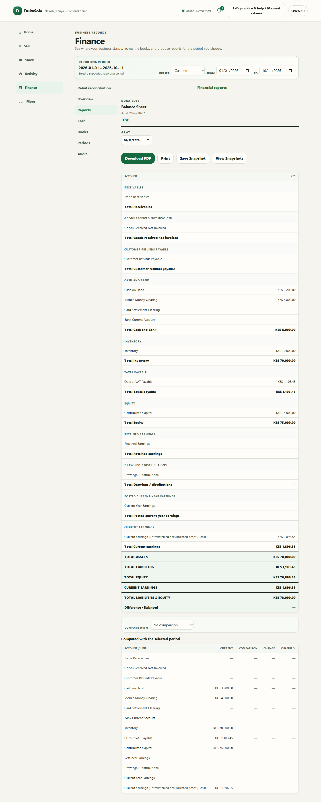

# DukaSole: reviewer screenshot walkthrough

[Open the hosted guided tour](https://dukasole-reviewer-tour.honey-nova-6116.chatgpt.site) · [Selected engineering](ENGINEERING.md) · [Architecture](PORTFOLIO_ARCHITECTURE.md)

These are real screenshots of the public application's browser interface, captured **11 October 2026**. A fresh temporary database contains fictional products and a synthetic Owner account. No working business database, private customer contact, credentials or KYC document was opened or published. The hosted page is a screenshot walkthrough, not the live application. Its controls only navigate images.

The fixture starts with three footwear variants, ten pairs each, and KES 2,500 recorded cost per pair. It completes one KES 8,000 sale of two Brown Formal Shoes, with KES 4,800 recorded mobile money and KES 3,200 cash. All amounts in [capture evidence](screenshots/capture-evidence.json) are integer cents, matching the application's monetary representation.

## 1. Home

Staff start from Home and navigate to their permitted workspaces. This screen is captured before the example sale.

## 2. Stock

The fixture contains three fictional variants with received stock. Their acquisition cost is recorded before checkout, so Finance has cost evidence.

## 3. Checkout

Two pairs at KES 4,000 each produce KES 8,000. Quantity controls and line removal affect the draft, not an already completed sale. The Scan QR entry point uses existing product identifiers; this screenshot journey selects the product on screen and does not claim to exercise a camera.

## 4. Payment allocations

KES 4,800 mobile money and KES 3,200 cash match the total. These are recorded inputs, **not** a Daraja prompt or payment-provider settlement. Entering payments does not silently complete the sale.

## 5. Review before completion

The existing review step separates a saved draft from explicit commercial completion.

## 6. Completed sale

A persisted receipt and stock effect now exist. Customer receipt requests and promotional choices are separate. This screenshot fixture collects no real contact and sends no SMS.

## 7. Invoice

The invoice represents the same completed sale: KES 8,000 total, KES 6,896.55 net amount, KES 1,103.45 tax, and the recorded payment allocations. Seller information is fictional. The document itself states that it is **not fiscally issued**. A template logo or local QR is not evidence of KRA acceptance or regulator approval.

## 8. Credit-note preparation

The form prepares a one-pair return linked to the original frozen sale, with reason and justification. **It is not submitted in this screenshot fixture.** The final Finance screen therefore remains at the after-sale stage. The separate Golden Transaction tests exercise completed credits, stock returns and accounting reversals.

## 9. Finance

The completed-sale fixture's calculated Balance Sheet was independently checked during capture:

- Assets: KES 78,000.00.
- Liabilities: KES 1,103.45.
- Equity: KES 76,896.55, including KES 1,896.55 current earnings.
- Liabilities + equity: KES 78,000.00.
- Balance difference: KES 0.00.

## Screenshot provenance and private tooling

The screenshot generation tool and full application remain private. The original capture used its own loopback-only temporary fixture, checked the sale total and Balance Sheet equation, and closed the browser/server. It did not use the working installation. Authenticated fixture setup was test-only, not a new application login or public bypass. The public repository includes the images and synthetic calculation evidence, not the complete capture implementation or private database.

External KRA/eTIMS, OSCU/VSCU, Daraja and SMS connectors remain inactive. DukaSole is shown as an internal business tool and workflow automation system, not as an implemented autonomous AI agent.
